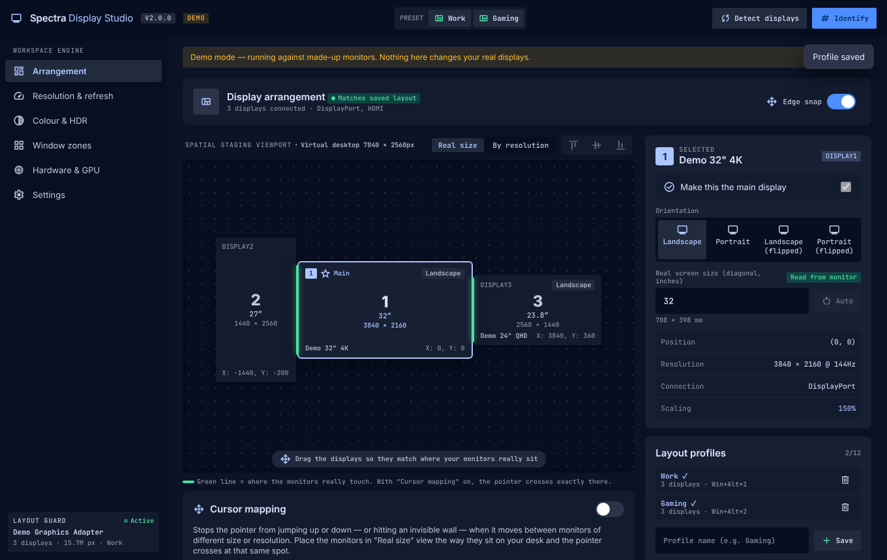

<div align="center">

# Spectra Display Studio

**멀티 모니터 배치·설정·보호를 한 곳에서.**

예전 이름은 *DisplayGuard*입니다. 전체 화면 게임 때문에 Windows가 모니터 배치를
뒤섞으면 원래대로 되돌려 주는 기능은 그대로이고, 여기에 드래그 배치, 해상도·주사율,
컬러·HDR, 창 분할 구역, GPU 실시간 모니터링이 더해졌습니다.

[다운로드](../../releases) · [기능](#기능) · [사용법](#사용법) · [English](README.md)



<sub>스크린샷은 가상 모니터를 쓰는 데모 모드에서 찍어 DEMO 표시가 있습니다. 실제 앱은 한국어로도 표시됩니다.</sub>

</div>

---

## 기능

| 페이지 | 할 수 있는 일 |
|--------|---------------|
| **디스플레이 배치** | 모니터를 **실제 크기 기준**으로 그려 놓고 드래그로 배치(자석 스냅), 주 모니터 지정, 회전, 배치 **프로필** 저장·전환, **배치 보호** 켜기/끄기. **마우스 이동 보정**을 켜면 크기·해상도가 다른 모니터 사이에서도 마우스가 실제로 맞닿은 위치로 넘어갑니다. |
| **해상도 및 화면 주사율** | 드라이버가 제공하는 모드 중에서 선택. 화면이 이상하면 15초 뒤 자동으로 이전 설정으로 복구됩니다. |
| **컬러 및 HDR** | 모니터별 RGB 게인·감마·밝기·명암(소프트웨어 보정), DDC/CI를 통한 모니터 자체 밝기·명암 조절, Windows HDR 스위치. |
| **가상 작업 공간** | 모니터마다 분할 구역을 정하고, 단축키나 **Shift**를 누른 채 창을 놓아 구역에 맞춥니다. |
| **하드웨어 및 GPU** | 그래픽 어댑터·디스플레이 연결 정보, DDC/CI 진단, 리포트 내보내기, GPU 실시간 센서(읽기 전용, NVIDIA). |

### 배치 보호

전체 화면 게임을 켜거나 끌 때 Windows가 모니터 배치를 바꿔 버리는 경우가 많습니다.
창이 다른 화면으로 튀고, 모니터 위치가 뒤바뀝니다. Spectra Display Studio는 이 변화를
감지해 몇 초 뒤 저장된 배치(위치, 해상도, 주사율, 방향, 주 모니터)로 되돌립니다.

**게임에는 전혀 손대지 않습니다.** 모든 동작은 Windows 디스플레이 설정 수준에서만
이뤄지므로 메모리 주입이나 오버레이가 없고, 안티치트에 걸릴 일이 없습니다.

## 다운로드

[**Releases**](../../releases) 페이지에서 최신 설치 파일
`SpectraDisplayStudio-Setup-x.y.z.exe`를 받으세요. Python은 필요 없습니다.
기존 DisplayGuard 1.x 위에 그대로 설치되며 저장된 배치를 이어받습니다.

설치는 **사용자 단위**(관리자 권한 불필요)이고, Windows 시작 시 자동 실행을 선택할 수 있습니다.

> **SmartScreen 안내:** 아직 서명되지 않은 빌드라 처음 실행할 때 Windows SmartScreen
> 경고가 뜰 수 있습니다. **추가 정보 → 실행**을 누르면 됩니다.

## 사용법

1. **Spectra Display Studio**를 실행합니다. (Windows 시작 시 자동 실행되면 트레이에만 뜹니다.)
2. **디스플레이 배치**에서 모니터를 책상 위 실제 위치에 맞게 끌어다 놓고 **배치 적용 및 저장**을
   누릅니다. 이 배치가 보호 기준이 됩니다.
3. 게임을 하세요. Windows가 배치를 바꾸면 자동으로 복원됩니다.

창을 닫아도 트레이에서 계속 실행되며, 트레이 아이콘을 누르면 다시 열립니다.

### 실제 크기 보기와 마우스 이동 보정

Windows는 모니터를 픽셀 기준으로 배치합니다. 그래서 27인치 4K가 32인치 QHD보다 크게
그려지고, 크기나 해상도가 다른 모니터 사이를 넘어갈 때 마우스가 위아래로 튀거나
보이지 않는 벽에 막힙니다.

- **실제 크기 기준**(배치 화면의 기본값)은 모니터가 알려주는 실제 크기대로 그립니다.
  크기가 틀리면 오른쪽 패널에 대각선 길이(인치)를 직접 입력하세요.
- **초록 선**은 마우스가 옆 모니터로 넘어갈 수 있는 구간입니다.
- **마우스 이동 보정**을 켜면 그 화면에서 모니터가 맞닿은 위치 그대로 마우스가 넘어갑니다.
  넘어가는 위치를 바꾸려면 모니터를 위아래로 끌어 옮긴 뒤 **배치 적용 및 저장**을 누르세요.

마우스 이동 보정은 기본으로 꺼져 있고, 게임이 마우스를 화면 안에 가둔 동안에는 멈춥니다.

### 단축키 (가상 작업 공간)

| 키 | 동작 |
|----|------|
| `Win` + `Alt` + `←` / `→` | 활성 창을 이전 / 다음 구역으로 이동 |
| `Win` + `Alt` + `↑` | 활성 창을 모니터 전체로 채우기 |
| `Win` + `Alt` + `1`~`3` | 배치 프로필 1~3 적용 |
| 창을 놓을 때 `Shift` | 마우스 아래 구역에 맞추기 |

## 소스에서 빌드

```
pip install -r requirements.txt pyinstaller
.\build.ps1 -Version 2.0.0
```

Windows, Python 3.12, Inno Setup 6이 필요합니다. 빌드 없이 실행하려면
`python spectra_studio.py`, 실제 하드웨어 없이 화면만 보려면 `--demo`를 붙이세요.

## 알려진 제한

- Windows 전용 (10 1903 이상 / 11, 64비트).
- 앱 창은 Microsoft Edge 또는 Chrome으로 표시됩니다(Edge는 Windows에 기본 포함).
  둘 다 없으면 기본 브라우저에서 열립니다.
- 앱 창은 한국어와 영어를 지원합니다. 트레이 메뉴와 활동 로그는 9개 언어를 지원합니다.
- 화면 배율(DPI)은 표시만 하고 변경하지 않습니다. Windows가 앱에 변경 방법을 제공하지 않습니다.
- 컬러 보정은 눈으로 맞추는 방식(감마 테이블)이며 측색기 기반 캘리브레이션이 아닙니다.
  HDR이 켜진 동안에는 Windows가 이 보정을 무시합니다.
- GPU 실시간 센서는 NVIDIA만 지원합니다. 오버클럭, 팬·전압 제어, 스트레스 테스트는
  의도적으로 넣지 않았습니다.
- 관리자 권한으로 실행된 프로그램의 창은 구역으로 옮길 수 없습니다.
- 서명되지 않은 빌드라 처음 실행 시 SmartScreen 경고가 뜹니다.

## 피드백

- 🐞 문제가 있나요? → [버그 신고](../../issues/new?template=bug_report.yml)
- 💡 아이디어나 기능 요청 → [여기에 남겨 주세요](../../issues/new?template=feature_request.yml)

## 라이선스

[MIT](LICENSE). 포함된 글꼴은 [`ui/fonts/LICENSES.txt`](ui/fonts/LICENSES.txt)에 있습니다.
