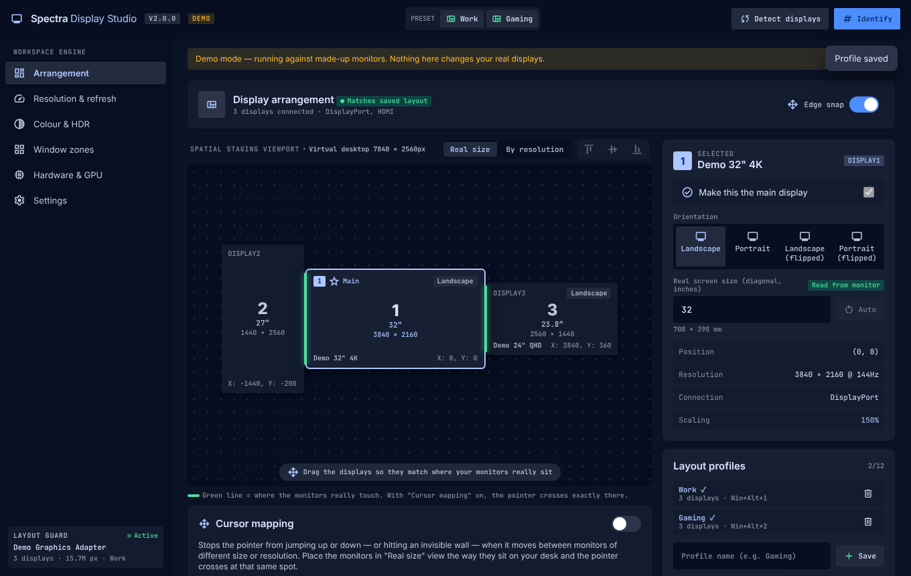
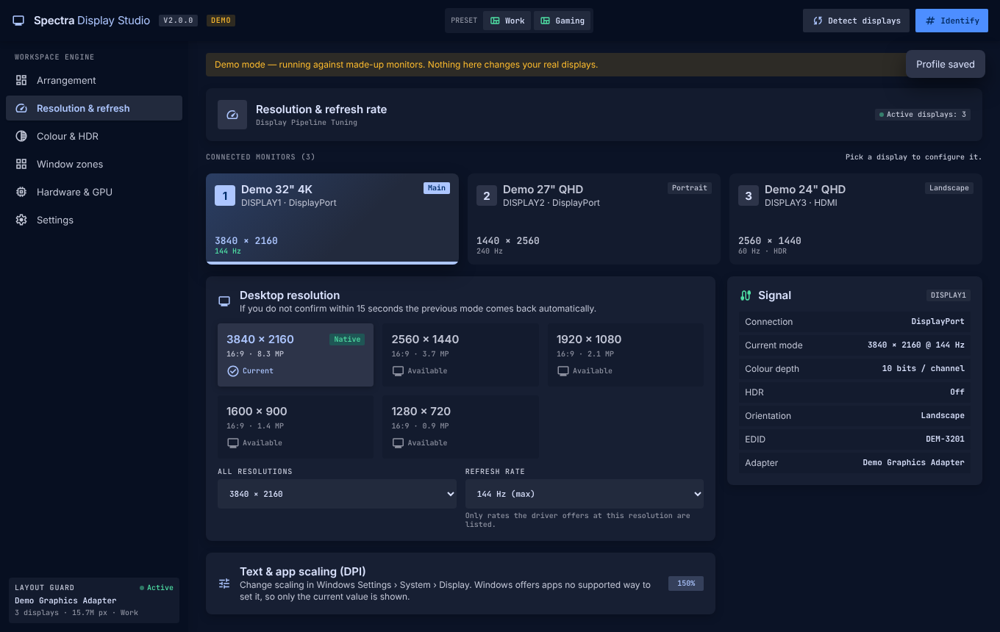
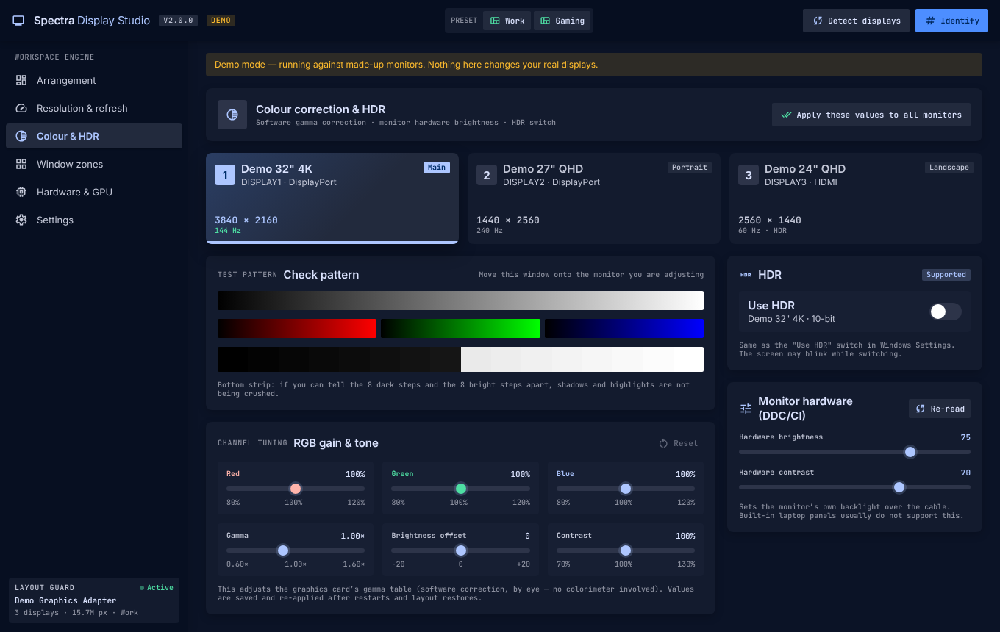
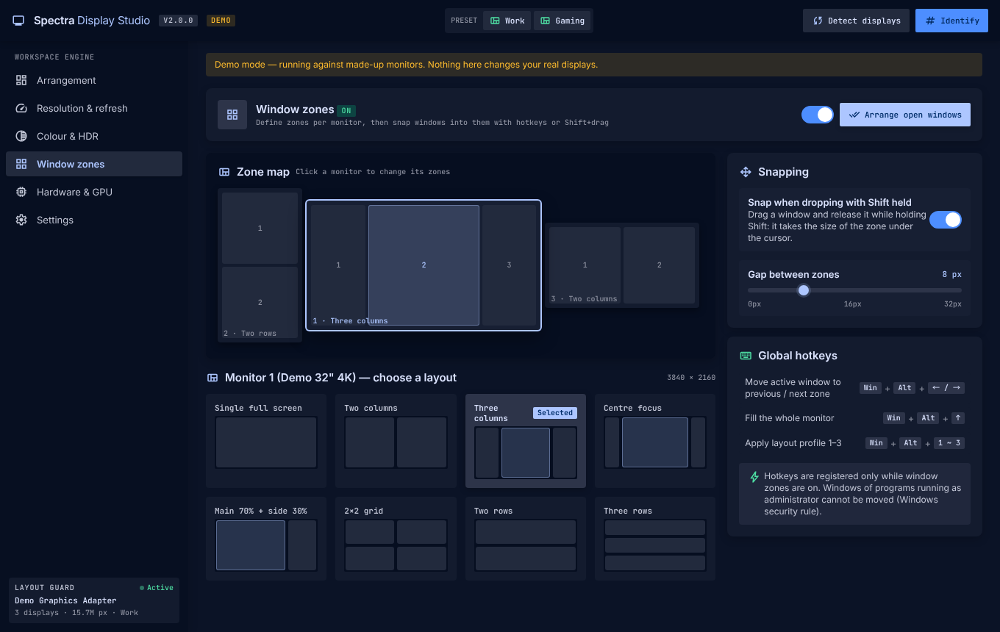
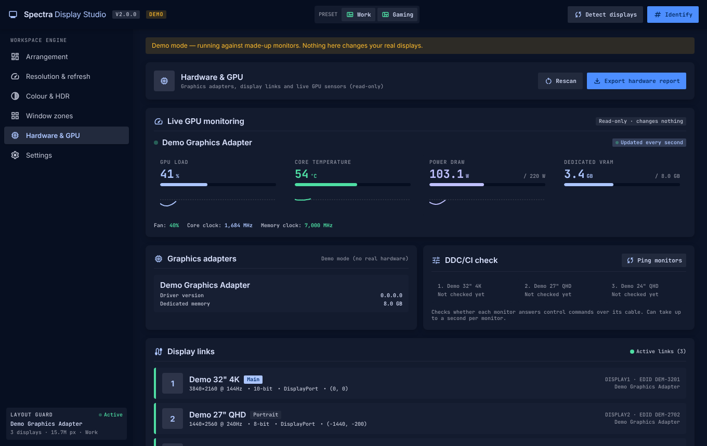

<div align="center">

# Spectra Display Studio

**Arrange, tune and protect your multi-monitor setup.**

Formerly *DisplayGuard*. It still does the thing it was made for — when a
fullscreen game makes Windows shuffle your monitors, it snaps the layout back —
and now adds a full studio around it: drag-and-drop arrangement, resolution and
refresh rate, colour and HDR, window zones, and live GPU monitoring.

[Download](../../releases) · [What it does](#what-it-does) · [Build from source](#build-from-source) · [한국어](README.ko.md)



<sub>Screenshots are taken in demo mode (made-up monitors), hence the DEMO badge.</sub>

</div>

---

## What it does

| Page | What you can do |
|------|-----------------|
| **Arrangement** | Drag monitors into place (with edge snap) in a **real-size view** that draws each monitor at its true physical size, pick the main display, rotate, save named layout **profiles**, and turn **layout protection** on or off. Optional **cursor mapping** makes the pointer cross between monitors where they really touch on your desk, instead of jumping or hitting an invisible wall when sizes or resolutions differ. |
| **Resolution & refresh** | Pick any mode the driver offers. A 15-second countdown reverts automatically if the picture is wrong. |
| **Colour & HDR** | Per-monitor RGB gain, gamma, brightness and contrast (software correction), the monitor's own brightness/contrast over DDC/CI, and the Windows HDR switch. |
| **Window zones** | Give each monitor a zone layout, then move windows into zones with `Win+Alt+←/→`, fill a monitor with `Win+Alt+↑`, or drop a window while holding **Shift**. |
| **Hardware & GPU** | Adapter and display link details, a DDC/CI check, an exportable report, and live read-only GPU sensors (NVIDIA). |

### Screenshots

| Resolution & refresh | Colour & HDR |
|---|---|
|  |  |

| Window zones | Hardware & GPU |
|---|---|
|  |  |

### Layout protection

When you launch or quit a fullscreen game, Windows often rearranges monitors —
windows jump to the wrong screen, displays swap positions. Spectra Display Studio
listens for the change and restores your saved layout a couple of seconds later
(position, resolution, refresh rate, orientation and main display).

**It never touches the game.** Everything happens at the Windows display level —
no injection, no overlay, nothing an anti-cheat could flag.

## Download

Grab the latest installer from the [**Releases**](../../releases) page:
`SpectraDisplayStudio-Setup-x.y.z.exe`. No Python required. It upgrades an
existing DisplayGuard 1.x install in place and keeps your saved layout.

The installer is **per-user** (no admin/UAC prompt), and offers to start the app
automatically with Windows.

> **SmartScreen note:** until the binary builds up download reputation, Windows
> SmartScreen may show a warning on first run. Click **More info → Run anyway**.

## Usage

1. Run **Spectra Display Studio**. (When it starts with Windows it goes straight to the tray.)
2. On **Arrangement**, drag your monitors to match your desk and click **Apply & save** —
   that layout is now the protected one.
3. Play your game. If Windows changes the arrangement, it is restored automatically.

Closing the window keeps the app running in the tray; click the tray icon to reopen it.

### Real-size view and cursor mapping

Windows arranges monitors by pixels, so a 27″ 4K panel looks bigger than a 32″
QHD one and the pointer jumps — or hits an invisible wall — when it crosses
between monitors of different size or resolution.

- **Real-size view** (the default on the Arrangement page) draws every monitor at
  its true physical size, read from the monitor itself. If a size is wrong, type
  the diagonal in inches in the panel on the right.
- The **green lines** show where the pointer can cross to the next monitor.
- Turn on **Cursor mapping** and the pointer crosses exactly where the monitors
  touch in that view. To change the crossing point, drag a monitor higher or
  lower and click **Apply & save**.

Cursor mapping is off by default and pauses while a game confines the pointer.

### Hotkeys (Window zones)

| Keys | Action |
|------|--------|
| `Win` + `Alt` + `←` / `→` | Move the active window to the previous / next zone |
| `Win` + `Alt` + `↑` | Make the active window fill its monitor |
| `Win` + `Alt` + `1`–`3` | Apply layout profile 1–3 |
| `Shift` while dropping a window | Snap it to the zone under the pointer |

## How it works

The app is a small background process plus a window:

- **Core** (`core.py`, `displays_win.py`): pure `ctypes` Windows API calls —
  `ChangeDisplaySettingsEx` for layouts and modes, `QueryDisplayConfig` for monitor
  names/HDR, gamma ramps for colour, DDC/CI through `dxva2`, `RegisterHotKey` and
  `SetWindowPos` for zones, NVML for GPU sensors.
- **Window** (`ui/`): plain HTML/CSS/JS shown in a chromeless Microsoft Edge (or
  Chrome) app window. It talks to the core over a local server (`server.py`) that
  only listens on `127.0.0.1` and requires a per-launch token, so other programs
  and web pages cannot drive your display settings through it.

`--demo` runs everything against made-up monitors (`displays_mock.py`), which is
also what happens on non-Windows machines — handy for working on the UI.

## Build from source

```
pip install -r requirements.txt pyinstaller
.\build.ps1 -Version 2.0.0
```

Requires Windows, Python 3.12 and Inno Setup 6. To run without building:
`python spectra_studio.py`.

## Known limitations

- Windows only (10 1903+ / 11, 64-bit).
- The window needs Microsoft Edge or Chrome (Edge ships with Windows); without
  either it opens in your default browser.
- The window is in Korean and English. The tray menu and activity log support
  9 languages.
- Display scaling (DPI) is shown but not changed — Windows gives apps no supported
  way to set it.
- Colour correction is by eye (gamma tables), not measured calibration, and
  Windows ignores it while HDR is on.
- Live GPU sensors are NVIDIA-only. Overclocking, fan/voltage control and stress
  testing are deliberately not included.
- Windows of programs running as administrator cannot be moved into zones.
- Cursor mapping is off by default, pauses while a game confines the pointer, and
  relies on the monitor reporting its size (you can enter the diagonal yourself).
- The build is **unsigned**, so SmartScreen warns on first run.

## Feedback

- 🐞 Something broken? → [open a bug report](../../issues/new?template=bug_report.yml)
- 💡 Idea or feature request? → [tell me here](../../issues/new?template=feature_request.yml)

## License

[MIT](LICENSE). Bundled fonts are listed in [`ui/fonts/LICENSES.txt`](ui/fonts/LICENSES.txt).
